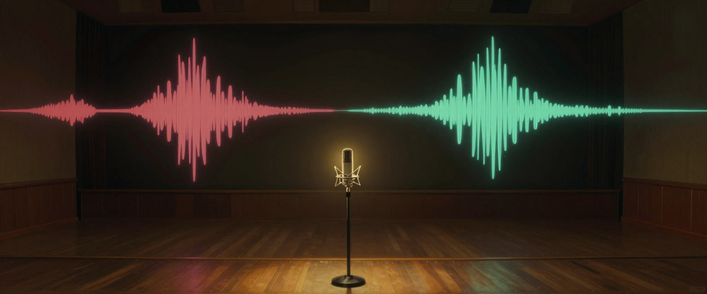

# voicewright



Original, consistent voices for games, films, narration and stories, kept on disk so you can rebuild them a year later.

Generated voices tend to fail the same ways: ten characters collapse into a few voices, last month's narrator comes back, a line drifts into someone else, and the type you asked for arrives as a caricature. voicewright is an agent skill and a small script that turn each of those into a check, and leave the final call to your ear.

## What you get

- **Voice sheets and a blind listen.** A brief like "a sassy maid" becomes several candidates, some written as pitch, resonance, texture and pace, and you pick by ear. In our one blind test, trait prompts and plain briefs tied 2 to 2, so neither gets a free pass.
- **A voice bible.** One `voices.json` with the sheet, reference clip and transcript, hashes, engine, model version, seed, pronunciation list, and rights.
- **Measured checks.**

| command | question |
|---|---|
| `vw.py cast` | Are any two voices in this cast too close? |
| `vw.py library` | Is this new voice one we already used, or an engine preset? |
| `vw.py line` | Is this line still the same voice as its reference? |
| `vw.py measure` | Clipping, noise floor, level jumps, long tails, sibilance, steady tones, flat reads |
| `vw.py validate` | Can every voice be rebuilt from these files? |
| `vw.py finish` | Trim and level for film, game, narration, audiobook or web |
| `vw.py review` | One clip of the whole batch to listen to |

- **Consent built in.** It will not clone a real person without written consent and declines imitations of named people, offering a designed voice instead.

## Hear it

[A four-voice pilot scene](.github/samples/pilot-scene.mp3) (MP3, unmixed, no room tone). The scene and voices are invented, and all of it is AI-generated with VoxCPM2, the default clone engine.

## Install

```
claude plugin marketplace add m4bwav/voicewright
claude plugin install voicewright@voicewright
```

The bible and level checks need only Python 3.9+. Pitch and spectrum need numpy. Identity checks need numpy, onnxruntime and a 27 MB speaker model (`vw.py setup`; WeSpeaker CAM++, CC BY 4.0). `finish` and `review` need ffmpeg. Engines are separate: voicewright helps pick one and includes a batch runner for Qwen3-TTS.

## How far to trust the numbers

The speaker thresholds were calibrated on 26 real speakers from Mini LibriSpeech: at 0.55, no same-speaker pair fell below and 0.06% of different-speaker pairs reached it. That is clean read speech, not generated or acted speech. Other clip thresholds are starter values, marked as such in [thresholds.md](skills/voicewright/references/thresholds.md). Nothing here detects metallic sound reliably, and a passing score does not mean a voice is good.

## Works with

cinewright and musicwright read the same bible file; neither needs the other installed. Licensing and law notes are dated, not legal advice.

## Licence

MIT. See [SECURITY.md](SECURITY.md) to report a problem.
